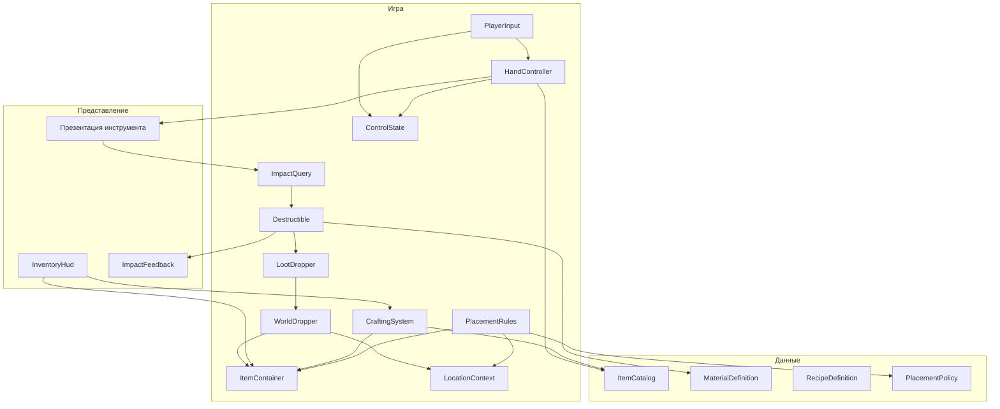
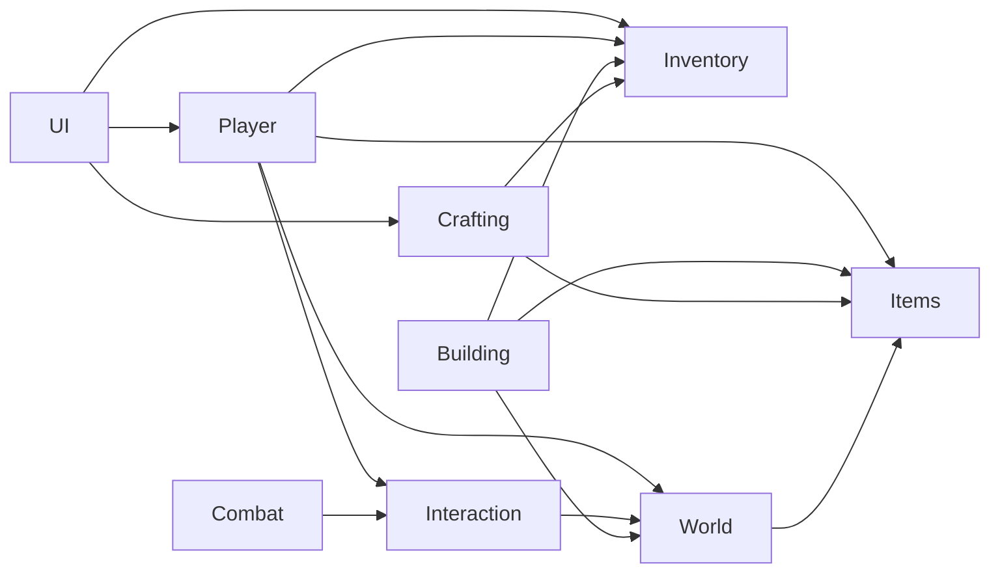
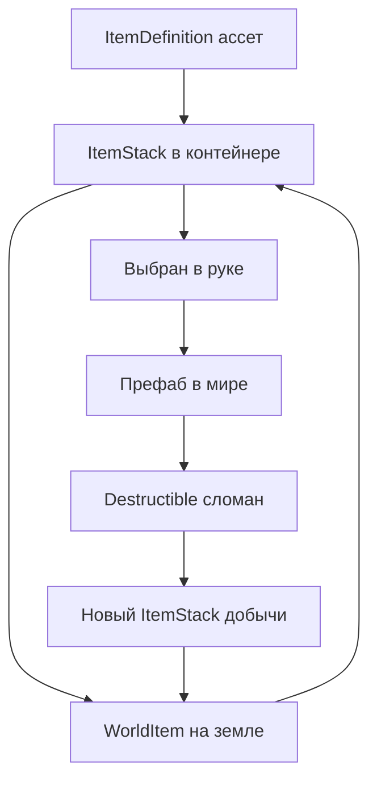
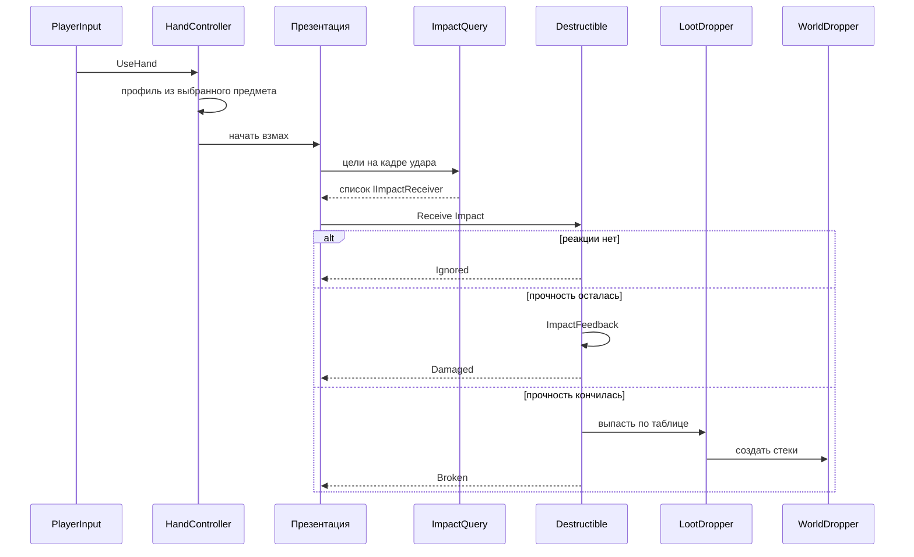
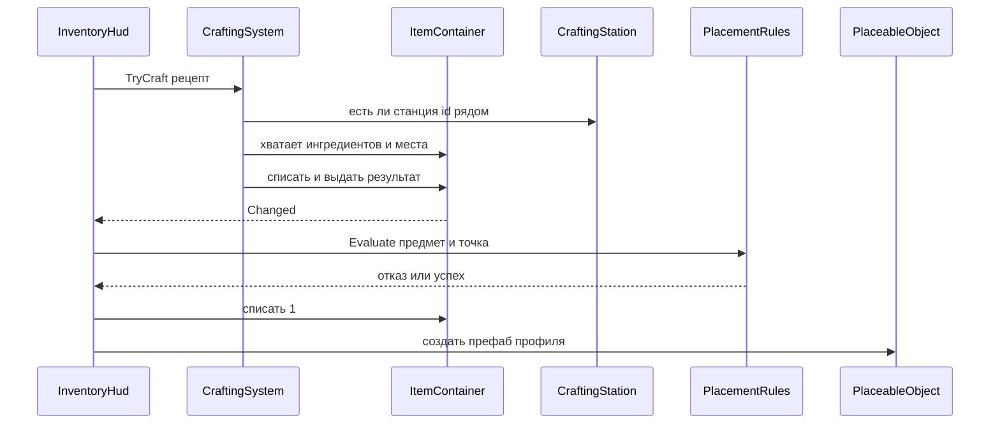

# Архитектура проекта

Документ фиксирует принятую архитектуру и то, что уже лежит в коде. Решения, которые при реализации отличались от первого черновика, собраны в [DECISIONS.md](DECISIONS.md).

Связанные документы:

- [PROJECT_STRUCTURE.md](PROJECT_STRUCTURE.md) — папки и правила, куда класть новые файлы.
- [SYSTEM_DEPENDENCIES.md](SYSTEM_DEPENDENCIES.md) — кто от кого зависит и какие связи запрещены.
- [ROADMAP.md](ROADMAP.md) — что уже сделано и что осталось.
- [DECISIONS.md](DECISIONS.md) — почему реализация отошла от черновика.

## Статус реализации

В коде уже работают:

- `GameRoot` только связывает игрока: крафт, установка, предмет в руке, HUD инвентаря, дочерний топор. Правил игры в корне нет.
- `ControlState` со стеком причин. Инвентарь и меню мира блокируют движение, удар, инструмент, слоты, установку и взаимодействие. Закрытие одной причины не снимает другую.
- `Impact`, `ImpactType`, `ImpactLibrary`, `IImpactReceiver`, `ReceiverRegistry`, `Destructible`, `LootDropper`, `ImpactFeedback`.
- Материалы `wood`, `furniture`, `stone`, `creature`. Прочность хранится на экземпляре `Destructible`, не на материале.
- Топор читает `ToolProfile` и не знает классы дерева, стула и камня. Меч и стрела шлют `Slash`. Укус врага по-прежнему идёт в `PlayerVitals`.
- `ItemContainer` и фасад `PlayerInventory`. Выброс идёт через `WorldDropper` и `LocationContext`.
- `LocationFlow` — единственное место с именем сцены `HouseInterior`. `LocationState` держит сессионную мебель и снятые объекты. Это не файл сохранения.
- Старый путь `IDamageable` / `Damageables` удалён, чтобы один удар не применялся дважды.

Ещё не сделано и не считается реализованным:

- Файл сохранения и сериализация мира.
- Перенос программного UI в префабы.
- Отдельные предметы кирки и молота. Совместимость проверена типами удара и материалами, а не этими предметами.
- `IInteractable` на двери. Дверь уже спрашивает `ControlState` и зовёт `LocationFlow`.
- Удаление запасного `DefaultContent` и запасного профиля топора. Пока ассет топора без профиля, `ItemDefinition.ResolvedTool` подставляет рубку.
- Генерация уровня 1 по сиду.

## 1. Назначение архитектуры

Игра — одиночная 2D pixel-art с изометрией. Ближайшие ориентиры по ощущению мира: Stardew Valley и Terraria. Собственные механики будут нарастать: предметы, инструменты, разрушаемые объекты, мебель, крафт, локации, позже бой, магия, сундуки, торговля, сохранения.

Архитектура должна позволять добавлять новый предмет, инструмент, материал или локацию **данными и компонентами на префабе**. Существующие классы при этом не обрастают новыми ветками `if (id == "axe")`.

Ограничение по весу: не вводим DI-контейнер, EventBus, Service Locator, ECS и отдельную сборку на каждую папку. Эти инструменты решают проблемы, которых у проекта ещё нет, и сами становятся кодом, который нужно поддерживать.

## 2. Что есть сейчас

Игровой код — около 55 скриптов в глобальном пространстве имён, одна сборка `Assembly-CSharp`. Отдельных asmdef у игры нет. Сцены в билде: `Game`, `HouseInterior`, учебная `SampleScene`. Пакеты: URP 2D, Input System, 2D Sprite / Tilemap / Aseprite. Своей системы сохранений нет.

Уже заложено несколько правильных швов, их нужно сохранять:

- `ItemDefinition` и `RecipeDefinition` — ScriptableObject, каталог умеет подниматься из `Resources/GameContent`.
- `CraftingSystem` проверяет рецепт и меняет инвентарь только командами `TryConsume` / `TryAdd`. UI сам слоты не редактирует.
- `PlacementRules` — чистая проверка. Предпросмотр и установка ходят в одно место.
- `LocationContext` описывает «где мы стоим» через регион и вид локации. Правила размещения не смотрят на имя сцены.
- `CraftingStation` узнаётся по идентификатору станции, а не по подклассу верстака.
- `GameplayGate` отделяет «меню открыто» от `Time.timeScale`. `MenuOpen` теперь значит «движение запрещено стеком причин».
- `PlacedFurniture` — фасад над `LocationState` на время сессии.
- Числа оружия и врагов лежат в `WeaponStats` и `EnemyStats`, а не размазаны по формулам.

Этого недостаточно, потому что следующий слой механик упирается в три фундаментальные ошибки.

### Ошибка 1. Удар ничего не говорит о себе

`IDamageable.ApplyDamage(int amount, Vector2 point, Vector2 direction)` — это «нанеси N урона». Типа инструмента в контракте нет.

`Axe` сам ищет цель через `Damageables.FindBest`, сам решает, что сила равна 1, сам тратит стамину, сам рисует щепки и сам проверяет меню. `Tree` принимает любой такой удар и после трёх ударов сам создаёт древесину с зашитым `ItemIds.Wood`. `PlaceableObject` так же принимает любой удар и роняет сам себя.

Отсюда таблица совместимости негде хранить. Топор сегодня рубит и дерево, и стул, и верстак, потому что все они `IDamageable`. Камень в лесу (`ForestScenery`) вообще не получает компонент удара: это декорация. Кирка, молот и «топор не берёт камень» в эту схему не встают без новых `if` внутри топора или внутри каждого объекта.

Параллельно бой живёт другой дорогой. Меч не бьёт по `IDamageable`. `Enemy` сам опрашивает конкретный `LevitatingSword` и смотрит `StrikeReaches`. Лук бьёт через `Enemy.TryDamageSegment`. Враг знает класс меча. Меч не знает врага, но и общий контракт ему не предложен.

### Ошибка 2. Новый предмет — это правка нескольких центральных мест

Чтобы появился ещё один инструмент, сегодня нужно:

- константа в `ItemIds`;
- ветка в `DefaultContent.ConfigureItem`;
- ветка в `ItemArt` (иконки в ассетах пустые, картинку рисует код);
- новый `MonoBehaviour` на игроке с зашитым `ItemId`;
- для топора ещё и `PlayerInventory.EnsureAxe`, который создаёт объект в рантайме;
- `ItemCatalog.IsUsable` завязан на конкретные id древесины, верстака и стула.

`ItemDefinition` уже существует, но поведение предмета в него не входит. Определение смешивает стек, иконку, зону установки, радиус станции, прочность мебели и размер следа. Прочность топора как предмета при этом не хранится: поле `durability` у топора равно 1 и означает не износ, а чужую семантику мебели.

Каталог в ассетах и `DefaultContent` описывают одни и те же предметы дважды. Это два источника правды.

### Ошибка 3. Сборка игры спрятана

Нет точки, которая явно связывает системы. Игра собирается побочными эффектами:

- `PlayerInventory.Awake` сам добавляет `CraftingSystem`, `PlacementSystem`, `HeldProp`, `InventoryHud` и топор;
- `LevelWorld` сам находит игрока через `FindAnyObjectByType`, строит комнаты, ворота, лес, слаймов, миникарту и меню мира;
- `HouseVisit` — статический автомат сцены с именем `"HouseInterior"`;
- подбор предмета, дверь, враг, сортировка спрайтов ищут игрока или инвентарь в сцене во время игры.

Плюс много статических списков: каталог, локация, станции, разрушаемые, блокеры, враги, мебель, ворота меню. Часть из них уместна как реестр «кто сейчас в мире». Часть — скрытое глобальное состояние, которое нельзя подменить и легко забыть сбросить. Сбросы через `RuntimeInitializeOnLoadMethod` уже показывают, что статики больно живут между входами в Play Mode.

`LevelWorld` (порядка 800 строк) одновременно карта, генератор, переход, атмосфера, спавн врагов и фабрика UI. `Axe` и `LevitatingSword` одновременно анимация, прицеливание, попадание и правила удара. `InventoryHud` (порядка 900 строк) строит весь интерфейс кодом и в том же классе обрабатывает клики. `Enemy` совмещает здоровье, полоску HP, поиск игрока и знание о мече.

`GameplayGate.MenuOpen` — один флажок. Его ставит только инвентарь. Меню мира по Escape игрока не останавливает. Кнопки спавна слайма и меню мира сообщают «курсор над UI» отдельными статическими методами, которые вручную проверяет `PlayerCombat`. Следующее окно (диалог, сундук) снова будет решать, какую часть управления ему выключить.

Сохранение поверх этого будет болезненным: мебель дома лежит в статическом списке без файла, уличные объекты живут только пока жив объект комнаты, уровень 1 уничтожается в `ClearDungeon` и каждый раз генерируется новым `Random` без зерна. У деревьев нет устойчивых id.

## 3. Оценка

Текущая архитектура **достаточна для прототипа и опасна как фундамент**. Игра играет не «вопреки всему»: данные предметов, правила установки и крафт уже отделены лучше, чем типичный первый проект. Ломать это ради чистоты не нужно.

Оценка перехода: **умеренная**, если идти вертикальными срезами и не переписывать меч, генерацию мира и UI в одном заходе. Оценка становится высокой только при попытке сразу заменить все MonoBehaviour оружия на общую анимационную систему.

Подробный порядок — в [ROADMAP.md](ROADMAP.md).

## 4. Принципы, которые принимаем

1. **Данные описывают, компоненты реагируют.** Новый топор, дерево или рецепт — ассет и настройка префаба.
2. **Инструмент не знает тип цели.** Он создаёт `Impact`. Цель сама решает, принимает ли она такой удар.
3. **Совместимость живёт на материале цели**, с точечным переопределением на объекте. Общей таблицы «топор–дерево» в коде нет.
4. **Действие и реакция разделены.** Кто взмахнул, кто нашёл цель, кто посчитал прочность, кто выронил добычу, кто мигнул спрайтом — разные типы.
5. **Инвентарь — это данные слотов.** UI и мир получают команды и события, а не лезут в массивы.
6. **Один владелец режима управления.** Окна не выключают отдельные клавиши по своему усмотрению.
7. **Явная связь на сцене, реестр для тех, кто появился в мире.** `FindAnyObjectByType` в игровом коде не используем.
8. **Один корень сборки.** Не россыпь синглтонов. Исключения названы в разделе 5 и в [SYSTEM_DEPENDENCIES.md](SYSTEM_DEPENDENCIES.md).
9. **Определение и состояние разделены.** ScriptableObject не хранит текущую прочность конкретного стула.
10. **Существующие имена классов не меняем, пока тип ещё используется сценой.** Unity пишет в ассет `Assembly-CSharp::ИмяКласса`. Переименование и добавление namespace ломают ссылки в Inspector. Новые типы можно класть в namespace. Старые остаются в глобальном пространстве имён, пока их не заменит новый компонент и ссылки не будут перенесены осознанно.
11. **Композиция вместо иерархии предметов.** Не будет `Chair : Placeable : WorldObject` и `IronAxe : Axe : Tool`.

## 5. Модули

Модуль — это папка и набор типов с одним смыслом, а не отдельная сборка.

### 5.1. Core

**Отвечает за:** корень сцены `GameRoot`, режим управления `ControlState`, общие значения удара (`Impact`, `ImpactType`, `ImpactResult`).

**Не отвечает за:** правила предметов, генерацию комнат, вёрстку UI.

**С кем говорит:** все модули могут читать `ControlState` и пользоваться структурами удара. Менять режим может только тот, кто его открыл (инвентарь снимает ровно свой режим).

**Как получает зависимости:** `GameRoot` лежит в сцене `Game` и держит ссылки на игрока, каталог, локации. Объекты, которые создаются кодом и не могут получить ссылку в Inspector, один раз берут нужный сервис с `GameRoot.Active` и сохраняют его в поле. Это единственная новая глобальная точка. Это не Service Locator: через корень нельзя запросить «любой тип». На нём фиксированный набор свойств.

**Публично:** `GameRoot`, `ControlState`, `PlayerAction`, `Impact`, `ImpactType`, `ImpactResult`.

Почему `GameRoot`, а не ещё один менеджер на систему: двери, дроп и деревья создаются в рантайме. Им нужна одна заранее известная дверь в системы сцены. Прятать за ней каталог, инвентарь и генератор мира нельзя — эти ссылки и так должны быть в Inspector там, где объект лежит в сцене (игрок, HUD).

### 5.2. Items

**Отвечает за:** неизменяемые описания предметов, материалов, типов удара, таблиц добычи, профилей инструмента и установки.

**Не отвечает за:** слоты, положение в мире, текущую прочность, UI.

**С кем говорит:** никого не вызывает. Его читают инвентарь, рука, размещение, крафт, разрушаемые объекты.

**Как получает зависимости:** ассеты. Доступ к каталогу — `ItemCatalog.Active`. Это второе разрешённое глобальное чтение: каталог неизменяемый и один на игру.

**Публично:** `ItemDefinition`, `ItemCatalog`, `MaterialDefinition`, `LootTable`, `ToolProfile`, `PlaceableProfile`, `PlacementPolicy`.

`ItemIds` остаётся только как временные константы уже существующих предметов. Новые предметы константу не получают.

### 5.3. Inventory

**Отвечает за:** слоты, стеки, перенос, удаление, вопрос «поместится ли результат крафта».

**Не отвечает за:** иконки, клавиши, дом, камеру, то, как выглядит выброшенный предмет.

**С кем говорит:** отдаёт команды наружу через методы и событие `Changed`. Выброс сообщает `WorldDropper`, что нужно создать стек. Крафт и UI вызывают методы контейнера.

**Как получает зависимости:** `PlayerInventory` на том же объекте, что и игрок. Ссылку на `WorldDropper` получает из Inspector или с `GameRoot` один раз.

**Публично:** `ItemStack`, `ItemContainer`, фасад `PlayerInventory` (имя класса сохраняем).

Отдельный интерфейс `IItemContainer` вводим, когда появится второй контейнер (сундук). Пока он один, интерфейс не нужен: сундук потом реализует те же методы, и интерфейс появится на реальном втором типе, а не заранее.

### 5.4. Player

**Отвечает за:** перемещение, анимацию тела, здоровье и стамину, руку (какой предмет выбран и когда наступает кадр удара).

**Не отвечает за:** поиск деревьев по типу, правила крафта, генерацию мира, построение Canvas.

**С кем говорит:** читает ввод и `ControlState`, читает выбранный слот, просит `ImpactQuery` найти цели, шлёт `Impact`. Тратит стамину у `PlayerVitals`.

**Как получает зависимости:** компоненты на префабе игрока, ссылки в Inspector. Не ищет игрока в сцене: он и есть игрок.

**Публично:** `PlayerController`, `PlayerVitals`, `HandController`, `PlayerInput`.

`PlayerCombat` постепенно становится тонкой оболочкой над `HandController` либо удаляется, когда меч и лук перейдут на тот же путь. До этого этапа меч и лук не трогаем.

### 5.5. Interaction

**Отвечает за:** поиск цели в радиусе и доставку либо `Impact`, либо взаимодействия по клавише E.

**Не отвечает за:** анимацию взмаха, прочность конкретного дерева, добычу.

**С кем говорит:** рука и интерактивные объекты. Реестр целей пополняют сами цели в `OnEnable` / `OnDisable`.

**Как получает зависимости:** ниоткуда. Цели регистрируются сами. Это уже работает в `Damageables` и остаётся, потому что физический запрос без стабильных слоёв сейчас был бы отдельным проектом.

**Публично:** `IImpactReceiver`, `IInteractable`, `ReceiverRegistry`, `ImpactQuery`, `InteractionQuery`.

Два контракта, не один. Дверь можно открыть, но нельзя срубить. Сундук можно открыть и, отдельно, сломать, если на нём висит `Destructible`. Стул можно сломать и нельзя «использовать». Объединять это в `Interact(enum)` значит снова получить центральный переключатель.

### 5.6. World

**Отвечает за:** текущую локацию, переходы, границы ходьбы, родительский объект для дропа, генерацию уже существующих комнат.

**Не отвечает за:** содержимое инвентаря, формулы урона, вёрстку инвентаря.

**С кем говорит:** говорит игроку «поставь позицию и границу». Сообщает контекст размещению. Не вызывает методы топора и UI инвентаря.

**Как получает зависимости:** сцена и `GameRoot`. Имя сцены знает только `LocationFlow`.

**Публично:** `LocationContext` (уже есть), `LocationDefinition`, `LocationFlow`, `WorldDropper`.

`LocationContext.Active` — третье и последнее глобальное чтение. «Где игрок стоит» нужно размещению, дропу и переходам. Таскать ссылку через каждый вызов хуже, чем одно текущее значение, которое меняет только переход.

### 5.7. Building

**Отвечает за:** можно ли поставить предмет здесь, призрак, подтверждение, след уже стоящих объектов.

**Не отвечает за:** рецепт, по которому предмет скрафчен, и за то, чем этот объект потом ломается.

**С кем говорит:** читает профиль установки и `LocationContext`, списывает предмет у контейнера, создаёт префаб.

**Публично:** `PlacementRules`, `PlacementSystem`, `PlaceableObject` как визуальный и регистрируемый объект. Прочность и станция — соседние компоненты, не обязанности `PlaceableObject` навсегда. Пока метод `Create` жив, он остаётся фасадом, чтобы не переписывать вызовы в один день.

### 5.8. Crafting

**Отвечает за:** виден ли рецепт, хватает ли станции и ингредиентов, списание и выдача.

**Не отвечает за:** список всех предметов, расположение кнопок, прочность верстака.

**С кем говорит:** `ItemCatalog` за рецептами, `CraftingStation` за «станция этого id рядом», контейнер за ресурсами.

**Публично:** `RecipeDefinition`, `CraftingSystem`, `CraftingStation`.

Менять ядро крафта почти не нужно. Оно уже расширяется новым ассетом рецепта.

### 5.9. Combat

**Отвечает за:** здоровье актёра, контактный урон по игроку, движение конкретного существа, полоску HP.

**Не отвечает за:** рубку дерева и за анимацию меча игрока.

**С кем говорит:** здоровье существа реализует `IImpactReceiver`, когда меч перейдёт на `Impact`. До этого `Enemy` остаётся как есть. Контактный урон слайма по игроку — это не инструмент и не `Impact`. Слайм кусает `PlayerVitals`.

Почему не одна система на всё: прочность пня и ИИ прыжка — разные причины меняться. Общий между ними только факт «это тело получило удар». Общий механизм — `Impact` и `IImpactReceiver`. Отдельный механизм — `Enemy` / движение / атака существа по игроку.

Огонь, взрыв и аура потом выпускают тот же `Impact` по области. Для них не заводится третья система урона.

### 5.10. UI

**Отвечает за:** показать слоты, рецепты, полоски, подсказки и отправить команду по клику.

**Не отвечает за:** помещается ли стек, доступен ли рецепт, можно ли ставить мебель. Эти ответы он спрашивает и рисует.

**С кем говорит:** подписывается на `Changed` у контейнера, виталов и режима управления. Вызывает `TryCraft`, `ClickSlot`, `SetOpen`.

**Публично:** существующие виды. Новые окна не читают приватные массивы инвентаря.

Перенос Canvas из кода в префабы — отдельная поздняя задача для удобства спрайтов. На расширяемость механик она не влияет, поэтому не стоит в начале миграции.

### 5.11. Save

Сейчас модуля нет, и писать его рано. Архитектура оставляет ему место: сохраняются id определений и изменяемое состояние, не ссылки на живые MonoBehaviour.

Что должно уметь лечь в снимок без новой модели данных:

- слоты инвентаря (`itemId`, количество, позже износ);
- виталы и позиция игрока, id локации и точка;
- зерно генерации уровня 1 и список id уничтоженных заранее расставленных объектов;
- поставленные объекты: `itemId`, позиция, текущая прочность, id экземпляра;
- содержимое будущих сундуков тем же `ItemStack`.

`PlacedFurniture` при миграции мира становится состоянием локации «дом», а не вечным особым случаем. Файл сохранения пишется последним этапом, когда это состояние уже собрано в одном типе.

## 6. Предметы

Один предмет — один ассет `ItemDefinition`. Поведение, которого у предмета нет, остаётся пустым. Не появляется класс `Wood`, класс `Chair`, класс `Axe`.

Поля определения, которые остаются общими:

- `id` — стабильная строка, её пишем в сохранения и в стеки;
- имя, описание;
- иконка и мировой спрайт;
- `maxStack`;
- теги категории для фильтров UI (`Resource`, `Tool`, `Weapon`, `Placeable` можно оставить enum-ом категорий, это не логика).

Рядом, только если нужно:

- `ToolProfile` — тип удара, сила, дальность, стоимость стамины, форма цели (одна цель / дуга / круг), ссылка на префаб представления в руке;
- `PlaceableProfile` — префаб, след, политика размещения, необязательный id станции и радиус;
- позже `EquipProfile` — слот экипировки, без отдельной иерархии.

`ToolProfile` вложен в предмет, а не является базовым классом. Два топора с разными числами — два ассета. Общий материал дерева при этом один.

Иконка берётся из ассета. `ItemArt` остаётся временной подстановкой, пока у предмета не назначен спрайт, и перестаёт быть обязательной остановкой при добавлении предмета.

### Материал и совместимость

`MaterialDefinition` — отдельный ассет, потому что его делят многие объекты.

```csharp
[Serializable]
public struct ImpactReaction
{
    public ImpactType Type;
    public float Multiplier;
}

[CreateAssetMenu(menuName = "Game/Material")]
public class MaterialDefinition : ScriptableObject
{
    [SerializeField] ImpactReaction[] reactions;

    public bool TryReaction(ImpactType type, out float multiplier)
    {
        if (reactions != null)
        {
            for (int i = 0; i < reactions.Length; i++)
            {
                if (reactions[i].Type == type)
                {
                    multiplier = reactions[i].Multiplier;
                    return true;
                }
            }
        }

        multiplier = 0f;
        return false;
    }
}
```

Правило одно: **нет записи или множитель не больше нуля — удар не меняет прочность.** Инструмент об этом не знает. Он уже отправил удар и сыграл взмах.

Пример под таблицу из постановки. Это данные, не код инструментов.

| Материал или переопределение | Chop | Mine | Smash |
| --- | --- | --- | --- |
| Древесина живого дерева | 1 | нет | нет |
| Древесина мебели (дерево + свои реакции) | 1 | нет | 1 |
| Камень | нет | 1 | 1 |
| Железо | нет | 0.5 | 0.25 |

Стул и ящик используют материал мебели, а не материал живого ствола. Поэтому молот ломает стул и не валит дерево, хотя оба «деревянные». Различие лежит в данных объекта, а не в молоте.

Живой ствол не получает реакцию `Smash`. Добавление молота не требует открывать класс дерева.

Сила и прочность — целые по смыслу игры («три удара»), хранить их можно числом с плавающей точкой из-за множителей:

```text
если реакции нет или multiplier <= 0 → удар проигнорирован
иначе loss = max(1, ceil(power * multiplier))
integrity -= loss
```

Топор: `Chop`, сила 1. Дерево: прочность 3, множитель 1. Три удара. Молот: `Smash`, сила 2. Стул: прочность 2, множитель 1. Один удар. Кирка по дереву: реакции `Mine` нет. Прочность не меняется, взмах кирки всё равно проигрывается.

Переопределение на конкретном объекте — короткий список дополнительных `ImpactReaction` поверх материала. Оно нужно для исключения («этот ящик боится ещё и огня»), а не для повторного описания всего материала.

### Добыча

`LootTable` ссылается на `ItemDefinition` и диапазон количества. Дерево роняет древесину, потому что у его `LootDropper` стоит эта таблица. Стул роняет предмет стула. Сундук может уронить содержимое отдельно: это уже контейнер, не таблица добычи.

Инструмент таблицу не читает.

### Состояние экземпляра

```csharp
public struct ItemStack
{
    public string ItemId;
    public int Count;
}
```

Этого хватает для текущих стеков. Поле износа инструмента добавляется в структуру тогда, когда первый инструмент начнёт тупиться. Определение хранит максимум, стек — остаток. Пока поля нет, мы не изображаем систему прочности инструментов.

Мировой объект хранит свою текущую прочность в `Destructible`, не в ассете предмета.

## 7. Инвентарь и UI

`ItemContainer` — обычный класс, не `MonoBehaviour`. Внутри слоты. Он умеет:

- прочитать слот;
- добавить стек и вернуть, сколько не влезло;
- забрать по id;
- переложить, объединить, поменять местами;
- ответить, влезет ли результат после списания ингредиентов.

`PlayerInventory` остаётся компонентом игрока: владеет контейнером на 10 слотов, слушает клавиши, поднимает событие `Changed`, включает и выключает предмет в руке. Методы, которые уже вызывает UI (`TryAdd`, `TryConsume`, `ClickSlot`, `SetOpen`, `CountOf`), сохраняются как фасад. Благодаря этому HUD не переписывается в том же шаге, что и данные.

Сейчас отдельные «сумки» нет. Десять слотов — это и хотбар, и открытое меню. Так и оставляем, пока не появится реальная сумка. Когда она появится, хотбар станет либо диапазоном слотов того же контейнера, либо вторым `ItemContainer`. Перенос между ними — одна операция «забрать из A, положить в B». Сундук, склад и торговля используют тот же контейнер. Торговля добавляет цену снаружи, не внутрь слота.

Предмет не двигает слоты. Слот не знает, топор это или древесина, кроме вопросов стека, которые читаются из `ItemDefinition.MaxStack`.

Выброс: контейнер уменьшает стек и вызывает `WorldDropper.Spawn`. Бросок учитывает текущую локацию внутри дропера. `PlayerInventory` перестаёт знать `HouseInterior` и `LevelWorld`.

UI инвентаря подписывается на `Changed` и на кадр рисует то, что контейнер уже решил. Кнопка крафта вызывает `CraftingSystem.TryCraft`. Если рецепт недоступен, система возвращает причину, UI её показывает.

Блокировка персонажа при открытом инвентаре — это `ControlState.Push("inventory")`, а не знание HUD о `PlayerController`.

## 8. Взаимодействие и инструменты

### 8.1. Контракт удара

```csharp
public readonly struct Impact
{
    public readonly ImpactType Type;
    public readonly float Power;
    public readonly Vector2 Point;
    public readonly Vector2 Direction;
    public readonly Object Source;

    public Impact(ImpactType type, float power, Vector2 point, Vector2 direction, Object source)
    {
        Type = type;
        Power = power;
        Point = point;
        Direction = direction;
        Source = source;
    }
}

public enum ImpactOutcome
{
    Ignored,
    Damaged,
    Broken
}

public struct ImpactResult
{
    public ImpactOutcome Outcome;
    public float Applied;
}

public interface IImpactReceiver
{
    bool CanReceive { get; }
    Vector2 Origin { get; }
    float Height { get; }
    float Slop { get; }
    ImpactResult Receive(in Impact impact);
}
```

`ImpactType` — ScriptableObject с полем `id` (`chop`, `mine`, `smash`, позже `slash`, `fire`). Новый тип — новый ассет. Классы топора и дерева не открываются.

`Source` нужен для всплывающего урона и агро, не для того, чтобы дерево вызвало метод игрока.

Интерфейс здесь оправдан: получатели удара не образуют одну иерархию. Дерево, мебель, будущая стена и здоровье слайма только обещают принять `Impact`. Общего базового класса у них нет.

### 8.2. Кто что делает

| Шаг | Кто | Чего не делает |
| --- | --- | --- |
| Игрок нажал удар | `PlayerInput` | Не ищет объекты |
| Режим позволяет удар | `ControlState` | Не знает про топоры |
| Предмет в руке — инструмент | `HandController` читает `ToolProfile` | Не смотрит, дерево ли под курсором |
| Проигрывается взмах | презентация в руке (`Axe` на переходном этапе) | Не списывает древесину и не решает прочность |
| На кадре попадания ищутся цели | `ImpactQuery` | Не наносит урон |
| Считается сила | профиль инструмента уже вложил её в `Impact` | Цель может только принять или обнулить множителем |
| Прочность меняется | `Destructible.Receive` | Не знает класс топора |
| Вспышка, тряска, щепки | `ImpactFeedback` на объекте, цвет щепок из материала | Топор не создаёт «Chop Chip» |
| Объект уничтожен | `Destructible` вызывает `IBreakReaction` и `LootDropper` | Топор не вызывает `WorldItem.Toss` |
| Стек лежит на земле | `WorldItem` | Не знает, срубили его или выбросили |
| Подбор | `WorldItem` вызывает `TryAdd` у контейнера | Не рисует слоты |

`IBreakReaction` — маленький интерфейс для особого следствия, которое не является добычей. Пень после дерева — компонент `SpawnStumpOnBreak`. Стул этот компонент не вешает. `Destructible` вызывает все такие компоненты на том же объекте и не содержит кода пня.

### 8.3. Поиск цели

`ReceiverRegistry` заменяет список внутри `Damageables`. Объект регистрируется в `OnEnable` и снимается в `OnDisable`. Запрос копирует нынешний `FindBest`: ноги персонажа, точка прицела, дальность, попадание в вертикальный отрезок тела.

Для инструмента с формой «круг» или «дуга» тот же реестр возвращает несколько целей. Профиль говорит форму. Добавить инструмент, который задевает несколько объектов, — выставить форму в профиле. Класс дерева не меняется.

Существующий `Tree.FindAt` дублирует этот поиск и никому не нужен. Его удаляем, когда дерево перейдёт на реестр. До того не трогаем.

### 8.4. Разрушаемый объект

```csharp
public class Destructible : MonoBehaviour, IImpactReceiver
{
    [SerializeField] MaterialDefinition material;
    [SerializeField] ImpactReaction[] extra;
    [SerializeField] float integrity = 3f;

    public ImpactResult Receive(in Impact impact)
    {
        if (!TryMultiplier(impact.Type, out float multiplier) || multiplier <= 0f)
            return Ignored();

        float loss = Mathf.Max(1f, Mathf.Ceil(impact.Power * multiplier));
        integrity -= loss;
        if (integrity > 0f)
        {
            FeedbackHit(impact);
            return Damaged(loss);
        }

        Break(impact);
        return Broken(loss);
    }
}
```

`Break` выключает коллайдер и станцию, зовёт реакции разрушения, зовёт `LootDropper`, проигрывает короткую анимацию исчезновения, уничтожает объект. Всё это на самом объекте.

Мебель, которую нельзя сломать, просто не получает `Destructible`. Размещение у неё остаётся. Рычаг или дверь получают `IInteractable` и не получают `Destructible`.

### 8.5. Инструмент в руке

На переходном этапе `Axe` остаётся презентацией взмаха. Из него уходят поиск «что это за объект», число урона и рождение щепок. В кадр попадания он делает только:

```csharp
Impact impact = new Impact(profile.Impact, profile.Power, tip, direction, this);
List<IImpactReceiver> targets = query.Collect(feet, aim, profile.Range, profile.Shape);
for (int i = 0; i < targets.Count; i++)
    targets[i].Receive(impact);
```

Профиль читается из выбранного предмета, а не из `ItemIds.Axe` внутри анимации. Пока профиль не подключён, временный мост допустим: презентация топора подставляет известный `ImpactType` топора. Это удаляется, когда `HandController` начнёт передавать профиль в презентацию.

Новый молот на конечном шаге: ассет предмета, вложенный профиль (`Smash`, сила, дальность), префаб презентации. Если взмах такой же, как у топора, презентация переиспользуется. Новый C#-класс молота не нужен.

Лук и магия по области — другие презентации (`полёт снаряда`, `круг`), потому что у них другой жест. Иерархия `Bow : Axe` не появляется. Снаряд на попадании создаёт тот же `Impact`.

### 8.6. Взаимодействие по E

```csharp
public interface IInteractable
{
    bool CanInteract { get; }
    Vector2 Origin { get; }
    float Radius { get; }
    void Interact(InteractionContext context);
}

public sealed class InteractionContext
{
    public readonly Transform Actor;
    public readonly Vector2 Feet;
}
```

`HouseDoor` со временем реализует этот интерфейс и просит `LocationFlow` перейти. Он не ищет `PlayerController` каждый кадр и не управляет его скоростью. Подсказка «E — Войти» смотрит на результат запроса «есть цель взаимодействия», а не на собственный `FindAnyObjectByType`.

Верстак как станция крафта **не** требует E. Близость станции уже открывает рецепты. Это сохраняем. E нужен там, где есть отдельное действие: дверь, позже сундук и диалог.

### 8.7. Бой и мир

Общее:

- структура `Impact`;
- поиск целей;
- материалы, если существу можно задать уязвимость к рубке или огню;
- добыча через `LootDropper`.

Отдельное:

- движение и решение «укусить» у `Slime`;
- урон по игроку от контакта через `PlayerVitals`;
- полоска здоровья врага;
- анимация меча, пока она не переведена на презентацию.

Меч, когда до него дойдёт этап, перестанет быть типом, который враг опрашивает. Меч выпустит `Impact` типа `Slash`. Материал слайма примет `Slash`. Материал дерева `Slash` не содержит, поэтому мечом дерево не рубят, пока в материал дерева явно не добавят такую реакцию. Это снова данные.

Огонь: ассет `ImpactType` `fire`. Горящий куст или огненный шар шлют `Impact`. Объект с реакцией на `fire` теряет прочность или вешает на себя компонент горения, который ещё несколько тиков шлёт себе слабый `Impact`. Компонент горения не входит в топор.

## 9. Мир и локации

Локация описывается данными, а не строкой сцены.

```csharp
[CreateAssetMenu(menuName = "Game/Location")]
public class LocationDefinition : ScriptableObject
{
    [SerializeField] string id;
    [SerializeField] string displayName;
    [SerializeField] LocationKind kind;
    [SerializeField] string regionId;
}
```

`LocationContext` на комнате или интерьере хранит ссылку на это определение плюс уже существующие `RegionKind` и `PlayArea`. Геймплей читает контекст.

Имя сцены `HouseInterior` остаётся деталью загрузки внутри `LocationFlow`. Дверь ссылается на `LocationDefinition` и id точки появления. `PlayerController`, камера и HUD не знают, какая сцена сейчас добавлена аддитивно.

Текущую схему загрузки сохраняем по смыслу: сцена `Game` не выгружается, интерьер добавляется сверху, игрок и камера те же. Это правильное решение, его не заменяем «каждое помещение — полная перезагрузка».

Политика размещения — ассет, на который ссылается профиль предмета:

- верстак: регион дома, улица;
- стул: интерьер;
- будущая грядка: свой регион, без правки `ItemDefinition.Fits`.

`PlacementZone` и `switch` в `Fits` удаляются только когда политики стоят на существующих предметах и поведение совпало. До этого enum работает.

Разные правила для новой локации: новый `LocationDefinition`, новый `PlacementPolicy` или повтор уже существующей политики. Предметы, которым политика не подходит, сами не начинают ставить проверки имени сцены.

Уровень 1 можно по-прежнему генерировать. Для будущих сохранений у генерации должно появиться зерно, а у заранее созданных деревьев — устойчивый id. Это требование к этапу мира, не к нынешнему прототипу. Пока зерно не сохраняется, честно считаем, что поход в лес сбрасывается. Так код и работает сегодня: `ClearDungeon` уничтожает комнаты.

## 10. Крафт и размещение

Крафт оставляем моделью «рецепт — данные, система — проверка, UI — кнопка».

Рецепт уже содержит ингредиенты, результат, количество и id станции. Пустой id станции означает крафт руками. Добавить рецепт — новый ассет, строка в каталоге. Класс `CraftingSystem` не меняется.

Что добавляется данными, когда понадобится, без смены ядра:

- поле категории рецепта для вкладок;
- станция с новым id (`furnace`), новый рецепт ссылается на него, объект печи носит `CraftingStation` с этим id.

Станция не хранит список рецептов и не списывает инвентарь. Она только сообщает id и радиус. `CraftingStation.AnyInRange` уже делает это верно.

Размещение:

1. Выбранный предмет имеет `PlaceableProfile`.
2. Курсор снапается к изометрической сетке (`PlacementRules.Snap` уже есть).
3. `PlacementRules.Evaluate` проверяет политику локации, границу, пересечение с другими следами, блокеры вроде стен дома, дистанцию до ног.
4. Призрак красится из результата. Подсказку выбирает UI по коду отказа, не по классу предмета.
5. Подтверждение списывает один предмет и создаёт префаб из профиля.
6. Отмена — смена слота или закрытие режима. Отдельный «режим стройки навсегда» не обязателен: пока в руке устанавливаемый предмет, удар мыши ставит, а не бьёт. Это уже так и должно сохраниться. `ControlState` при этом не блокирует движение. Блокируется только действие руки «удар», потому что руку заняла установка. За это отвечает рука, а не каждый UI.

Разрушение поставленного объекта идёт через `Destructible`, тем же путём, что и дерево. Система размещения не содержит топора.

Проверка пересечений остаётся в `PlacementRules` и следах объектов. Она не переезжает в класс стула.

## 11. Управление

Вместо одного `MenuOpen` — стек причин.

```csharp
public enum PlayerAction
{
    Move,
    Sprint,
    UseHand,
    Interact,
    OpenInventory,
    DropItem,
    Place
}

public sealed class ControlState
{
    public void Push(string reason);
    public void Pop(string reason);
    public bool Allows(PlayerAction action);
    public event Action Changed;
}
```

Пока на стеке есть любая причина из интерфейса (`inventory`, `dialog`, `world-menu`), запрещены `Move`, `Sprint`, `UseHand`, `Interact`, `Place`. `DropItem` во время инвентаря остаётся разрешённым: Q уже выбрасывает предмет из курсора. Разрешение описывается в одном месте, в `Allows`, а не в каждом окне.

Закрытие инвентаря делает `Pop("inventory")` и не снимает диалог, если тот ещё открыт.

`GameplayGate` на первых шагах остаётся тонкой обёрткой: `MenuOpen` означает «движение сейчас нельзя». Старые проверки продолжают компилироваться. Новые проверки зовут `ControlState`. Когда вызовов `GameplayGate` не останется, обёртка удаляется.

Курсор над HUD больше не спрашивается у каждого виджета отдельно. Один метод «указатель над игровым UI» живёт рядом с HUD и читается рукой. `SlimeSpawnButton` — отладочная кнопка. Она не становится подсистемой. Пока она есть, она пользуется тем же методом, а не собственным статическим протоколом навсегда.

Ввод читает Input System в `PlayerInput` и наружу отдаёт уже намерения: вектор движения, «удар зажат», «взаимодействие нажато», «инвентарь», «выбросить», цифры слотов. Прямые проверки `Keyboard.current` для этих действий из геймплея уходят. Это не новый фреймворк ввода, а один компонент, чтобы смена привязки не требовала править топор, дверь и инвентарь по отдельности.

## 12. Сохранения

Постоянные данные — ассеты в `Assets/Data` (или пока `Assets/Resources/GameContent`). Они не пишутся в сейв.

В сейв попадает только то, что изменилось:

- `ItemStack` в контейнерах;
- текущие виталы;
- id локации, позиция, зерно процедурной локации;
- поставленные экземпляры и их прочность;
- id разрушенных объектов, которые были расставлены уровнем, а не игроком;
- содержимое контейнеров мира.

Загрузка создаёт объекты заново из id определений. `ScriptableObject` не восстанавливаем из JSON по ссылке сцены.

Пока сейва нет, состояние интерьера может жить в памяти в типе `LocationState`, тем же списком, что сегодня `PlacedFurniture`. Разница в том, что это состояние локации, а не особый статический класс мебели. Уличные предметы дома и так живут на объектах комнат, пока комната не уничтожена. Их в статический список переносить не нужно.

## 13. Какие приёмы используем и какую боль они закрывают

| Приём | Где | Какую проблему проекта закрывает |
| --- | --- | --- |
| ScriptableObject | предметы, рецепты, материалы, типы удара, политики, добыча | Новый контент без правки менеджера |
| Вложенный профиль, а не подкласс | инструмент и установка на предмете | У предмета может не быть этих свойств |
| Компоненты на префабе | `Destructible`, `LootDropper`, `CraftingStation`, `IInteractable` | Стул, верстак, дверь и несгораемый декор собираются по-разному |
| Интерфейс получателя | `IImpactReceiver`, `IInteractable` | Нет общего предка у дерева, слайма и двери |
| Обычный C#-класс | `ItemContainer`, `ControlState`, `PlacementRules` | Логику можно проверить без сцены и UI |
| MonoBehaviour | презентация, вид, регистрация в мире | Нужны кадр, ссылки Inspector и жизненный цикл |
| Реестр `OnEnable` | цели удара, станции, блокеры | Объекты создаются и исчезают, `Find` по сцене дорог и хрупок |
| Событие владельца | `Changed` у контейнера и виталов | UI обновляется, не опрашивая правила |
| Один `GameRoot` | сцена `Game` | Рантайм-объектам есть у кого спросить ссылку, и эта дверь одна |
| Стек режимов | `ControlState` | Окна не затирают блокировки друг друга |

Не используем:

- **Zenject и любые DI-контейнеры.** Ссылок в Inspector и одного корня хватает на размер команды. Контейнер спрячет связи, которые нам как раз нужно видеть.
- **Глобальную шину событий.** Событие живёт у владельца данных. Шина «обо всём» снова делает неявные зависимости.
- **Service Locator с `Get<T>()`.** От него не отличить случайный `Find`.
- **ECS.** Мир измеряется десятками интерактивных объектов, не десятками тысяч.
- **Интерфейс на каждый класс.** `PlayerController` интерфейса не получает, пока его не нужно подменять.
- **Asmdef на каждую папку.** Сборки не остановят логическую связность, если проекты ссылаются друг на друга, и замедлят итерации. Достаточно одной игровой сборки и папки `Editor`. Граница поддерживается правилами из [SYSTEM_DEPENDENCIES.md](SYSTEM_DEPENDENCIES.md).

Наследование оставляем там, где уже есть общий каркас с заменяемым куском и это дешевле композиции: временный `Tool` / `Weapon`, движение слайма поверх `Enemy`, пока здоровье не вынуто в компонент. Новые предметы в эти иерархии не добавляем. Новый жест руки — новая презентация, если жест другой, либо те же числа в профиле, если жест тот же.

## 14. Где какой вид типа

| Задача | Вид |
| --- | --- |
| Имя, иконка, стек, сила топора, рецепт | ScriptableObject или вложенные данные на нём |
| Текущие слоты, прочность стула, режим UI | Обычный класс или поля компонента |
| «Прими удар», «тебя можно нажать E» | Интерфейс |
| Пень, добыча, станция, блокировка клетки | Компонент на том же префабе |
| Взмах, полет стрелы, прыжок слайма | MonoBehaviour-презентация |
| Проверка «можно ли поставить» | Статический чистый класс, как сейчас `PlacementRules` |
| Связать игрока, каталог и локации в сцене | Один компонент `GameRoot` |

## 15. Сценарии расширения

Для каждого сценария перечислено, что создаётся. Если в списке есть правка `Axe`, `Tree`, `PlayerInventory` или `CraftingSystem`, сценарий провален. Ниже этого нет.

### 1. Новый инструмент, молот

Создать ассет `ImpactType`, только если `Smash` ещё нет. Создать `ItemDefinition` «Молот» с `ToolProfile`: тип `Smash`, сила, дальность, стамина, форма «одна цель», префаб взмаха (можно тот же, что у топора). Добавить иконку в ассет. Положить предмет в каталог.

Классы деревьев, стульев и топора не меняются. Стул разобьётся, только если его материал уже принимает `Smash`. Если не принимает — правится ассет материала мебели, не молот и не класс стула.

### 2. Новая каменная стена

Префаб: спрайт, `PlaceableProfile` на предмете, `Destructible` с материалом камня и прочностью, `LootDropper`. Предмет в каталоге. Инструменты не меняются. Кирка и молот уже выпускают `Mine` и `Smash`, камень их принимает.

### 3. Новый материал, железо

Новый ассет `MaterialDefinition` с реакциями. Объекты, которые должны стать железными, ссылаются на него. Инструменты и старые материалы не редактируются.

### 4. Новый тип воздействия, огонь

Новый ассет `ImpactType`. Источник огня (снаряд, лужа, заклинание) создаёт `Impact` этого типа. Горящие объекты получают реакцию в своём материале или компонент горения. Существующие инструменты не меняются и огонь не начинают наносить.

### 5. Деревянный сундук, который ломается

Префаб: `Destructible` (материал мебели), `LootDropper` или выпадение содержимого, позже `ItemContainer` и `IInteractable` для открытия. Топор уже шлёт `Chop`. Класс топора не меняется. Если контейнера в игре ещё нет, сундук на первом шаге только ломается и роняет предмет. Открытие добавляется вместе с вторым контейнером, а не внутрь топора.

### 6. Новый враг со своим здоровьем

Префаб: компонент движения, компонент здоровья, реализующий `IImpactReceiver`, свой материал (`Slash`, при желании `Chop` и `Fire`). Меч, когда он уже шлёт `Impact`, не меняется. Пока меч ещё старый, новый враг временно может использовать нынешний `Enemy.TakeDamage`, чтобы не блокировать контент. Целевое состояние — приём `Impact`, без ссылки на `LevitatingSword`.

### 7. Предмет ставится и не ломается

`PlaceableProfile` есть, компонента `Destructible` нет. Запросы удара его не находят. Размещение работает как у остальной мебели.

### 8. Объект активируется и не получает урон

Только `IInteractable`. Пример: дверь. `ImpactQuery` его не возвращает.

### 9. Инструмент бьёт несколько объектов

В `ToolProfile` ставится форма дуги или круга. `ImpactQuery.Collect` уже возвращает список. Цели по-прежнему сами фильтруют тип удара. Класс запроса меняется один раз, когда форма появляется, и дальше новые инструменты только выбирают её в данных. Существующие одиночные инструменты остаются формой «одна цель».

### 10. Объект по-разному отвечает на инструменты

Разные множители в `ImpactReaction` и, если нужно, разный `IBreakReaction`. Живое дерево: `Chop` × 1, три единицы прочности, таблица древесины, компонент пня. Ящик: `Chop` × 1 и `Smash` × 1, другая прочность, другая добыча, без пня. Топор в обоих случаях шлёт один и тот же `Chop`.

## 16. Сквозной пример: топор и дерево

1. В выбранном слоте предмет с профилем `Chop`, сила 1, дальность как у нынешнего топора.
2. `ControlState` разрешает `UseHand`. Режим установки не активен.
3. Презентация топора тратит стамину через `PlayerVitals` и играет замах. Это поведение руки, оно уже есть.
4. На кадре удара `ImpactQuery` возвращает не больше одной цели под прицелом в дальности.
5. В `Impact` лежат тип `Chop`, сила 1, точка лезвия, направление, источник.
6. `Destructible` дерева находит реакцию древесины. Множитель 1. Прочность 3 становится 2. `ImpactFeedback` трясёт ствол и рисует щепки цветом материала.
7. Третий удар доводит прочность до нуля. `SpawnStumpOnBreak` оставляет пень. `LootDropper` вызывает `WorldItem.Toss` для древесины из таблицы. Объект дерева уничтожается.
8. Игрок наступает на стек. `WorldItem` вызывает `ItemContainer.TryAdd`. HUD узнаёт об этом из `Changed`.

Топор по камню с материалом без `Chop`: шаги 1–5 те же. Шаг 6 возвращает `Ignored`. Камень не трясётся как срубленное дерево. Отдельной ветки в топоре нет.

Кирка по тому же камню отличается только полем `ImpactType` в профиле кирки.

## 17. Диаграммы

### Общая архитектура



### Зависимости основных систем

Стрелка означает «имеет право вызывать». Обратных стрелок нет: предмет не вызывает UI, инструмент не вызывает класс дерева.



`combat --> interaction` появляется на этапе, когда здоровье врага принимает `Impact`. До этого бой остаётся изолированным и на диаграмме текущего кода висит отдельно, со ссылкой на конкретный меч. Это как раз связь, которую убираем.

### Жизненный цикл предмета



Установка и разрушение — разные развилки. Предмет без профиля установки не попадает в `placed`. Объект без `Destructible` не попадает в `broken`.

### Удар по объекту



### Крафт и установка



Установка на диаграмме идёт из UI только как команды. Саму проверку выполняет `PlacementRules`. Сегодня клик установки живёт в `PlacementSystem`, и это нормальное место: вид призрака и команда рядом. Правило не живёт в кнопке.

## 18. Решения, которые нужно подтвердить до кода

Пока эти пункты не приняты, рефакторинг не начинается.

1. Совместимость инструмента и объекта хранится на материале цели. В инструменте только тип и сила удара. Общей таблицы пар нет.
2. Нет реакции на тип удара — цель не повреждается. Взмах всё равно проигрывается.
3. `ImpactType` — ассет, а не ветка в коде инструмента.
4. Бой с врагами переводится на тот же `Impact` отдельным поздним этапом. Укус врага по игроку остаётся прямым уроном по `PlayerVitals`.
5. Разрешены три глобальных чтения: `ItemCatalog.Active`, `LocationContext.Active`, `GameRoot.Active`. Новые синглтоны не заводим.
6. Не подключаем DI-фреймворк, шину событий, ECS и asmdef на каждый модуль.
7. Существующие классы не переименовываем и не переносим в namespace, пока на них смотрят сцены и префабы.
8. Хотбар остаётся теми же десятью слотами, пока не появится отдельная сумка.
9. Первый вертикальный срез — топор, дерево и поставленная мебель. Меч, лук и генерация уровня 1 в этом срезе не переписываются.
10. UI, собранный кодом, остаётся до стабилизации команд инвентаря. Спрайты предметов переезжают в ассеты `ItemDefinition` раньше, чем Canvas переезжает в префабы.
11. Целые по смыслу сила и прочность, множитель материала может быть дробным. Потеря прочности не меньше 1, если удар принят.
12. Уровень 1 продолжает сбрасываться при выходе, пока отдельно не решим хранить зерно генерации. Архитектура это место предусматривает, но не делает вид, что сохранение уже возможно.
