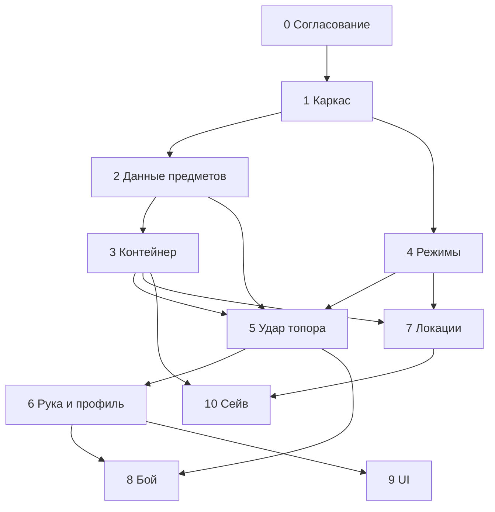

# План перехода

Порядок работ и что из него уже в коде. Расхождения с исходным планом записаны в [DECISIONS.md](DECISIONS.md).

## Статус

| Этап | Состояние |
|---|---|
| 0. Согласование | Принято, реализация пошла по этому плану с поправками из DECISIONS |
| 1. Каркас | Сделано. `GameRoot` создаётся после загрузки сцены, если в ней есть игрок |
| 2. Предметы | Частично. Каталог пригоден по наличию предметов и рецептов. Профиль топора есть в рантайме. `DefaultContent` ещё запасной генератор шести исходных предметов |
| 3. Контейнер | Сделано |
| 4. Управление | Сделано без отдельного класса `PlayerInput`. Существующие компоненты спрашивают `ControlState` |
| 5. Удар | Сделано. Камни леса тоже получают каменный материал, чтобы топор мог промахнуться по типу удара |
| 6–7. Локации и установка | Сделано в объёме зависимостей: поток локаций, дроп, политики размещения. Генерация комнат не переписывалась |
| 8. Бой | Сделано в объёме удара. Меч и стрела шлют `Slash`. Укус остаётся на виталах |
| 9. UI в префабы | Не делалось |
| 10. Файл сохранения | Не делалось. Данные уже разделены: описание отдельно, прочность и слоты отдельно |

## Правила переноса

- Один этап заканчивается тем, что сцена `Game` по-прежнему запускается: ходьба, удар меча, топор, дерево, инвентарь, крафт, установка, дом, уровень 1.
- Не переименовываем классы и не добавляем им namespace, пока на них есть ссылки сцены или префаба. Идентификатор скрипта Unity — это имя класса.
- Папку вместе с `.meta` можно перенести, когда этап и так трогает этот файл. Отдельный «наведём порядок в папках» не делаем.
- Новый путь встаёт рядом со старым. Старый вызов удаляется в том же этапе только после того, как поведение совпало. Двух разных ударов топора в игре не остаётся.
- Меч, лук и их анимация не входят в срез топора. Они продолжают работать по-старому, пока не начнётся этап боя.
- Не добавляем пакеты.
- Не меняем спрайтовый стиль и не пересобираем сцены ради архитектуры.

Порядок отличается от простого списка «сначала весь игрок, потом весь мир» в одном месте: **меч не переводится на общий удар вместе с топором**. Общий контракт сначала доказывается на топоре, дереве и мебели. Меч подключается позже, потому что сейчас он завязан на опрос `LevitatingSword` из `Enemy`, и ломать это в первом срезе значит смешать две боевые схемы в одном нерабочем промежутке.

Крафт в очередь почти не попадает отдельной перепиской. Он уже устроен как данные плюс проверка. Его слегка дополняют политики и категории, когда до них доходит мир и UI.

## Этапы

### Этап 0. Согласование

Кода нет. Подтверждаются решения в конце [ARCHITECTURE.md](ARCHITECTURE.md). Без этого следующий этап не начинается.

Готово, когда команда согласна, где живёт совместимость инструмента и объекта и что первый срез — топор.

### Этап 1. Каркас без смены поведения

Появляются `GameRoot`, `ControlState` и типы `Impact` / `ImpactType` / `ImpactResult` / `IImpactReceiver`. `GameplayGate.MenuOpen` начинает отражать `ControlState`, но все старые проверки остаются. На префаб игрока явно вешаются те компоненты, которые сегодня добавляет `PlayerInventory.Awake` (`CraftingSystem`, `PlacementSystem`, `HeldProp`, `InventoryHud`). После этого `AddComponent` этих систем из инвентаря удаляется. Топор пока можно оставить создаваемым кодом: его префаб — часть этапа руки.

Ни один объект ещё не обязан принимать `Impact`.

Готово, когда игра ведёт себя так же, а новые системы больше не появляются скрытым `AddComponent`.

Не трогаем: формулы топора, меч, генерацию комнат, вид HUD.

### Этап 2. Предметы как единственные данные

`ItemDefinition` получает необязательный `ToolProfile` и `PlaceableProfile`. Пустые профили значат «это не инструмент» и «это не ставится». Старые поля размещения остаются рабочими, пока профили не заполнены, чтобы ассеты не сломались в один день.

Каталог в `Resources/GameContent` становится источником правды. `DefaultContent` остаётся запасным путём только если ассет каталога не найден, и перестаёт быть местом, куда дописывают каждый новый предмет. `ItemCatalog.IsUsable` перестаёт требовать конкретные id: каталог пригоден, если в нём есть предметы и рецепты, а не если в нём есть именно древесина.

Иконки существующих предметов назначаются на ассеты. `ItemArt` остаётся запасным спрайтом и больше не ищет инвентарь в сцене.

Готово, когда топор, меч, лук, древесина, верстак и стул описаны ассетами, а запасной генератор не содержит новой логики.

Не трогаем: как именно топор наносит урон.

### Этап 3. Контейнер инвентаря

Слоты переезжают в `ItemContainer`. `PlayerInventory` остаётся фасадом с теми же публичными методами, поэтому `InventoryHud` и крафт не переписываются.

Выброс предмета вызывает маленький `WorldDropper`, который забирает у `LocationContext` родителя и границу. Из `PlayerInventory` уходят прямые обращения к `HouseInterior` и `LevelWorld`.

Готово, когда подбор, выброс, стек, крафт и установка ходят в фасад, а инвентарь не знает классов дома.

Не трогаем: число слотов, раскладку HUD, меч.

### Этап 4. Режимы управления

Инвентарь делает `Push("inventory")` и `Pop("inventory")`. Меню мира делает то же со своей причиной и наконец останавливает персонажа, пока открыто. Это заметное исправление поведения, оно осознанное: сейчас Escape открывает список путешествий, и персонаж продолжает идти.

`PlayerInput` собирает уже существующие действия Input System и клавиши слотов. Топор и дверь пока могут читать ввод по-старому, если перевод всех сразу раздувает этап. Минимум этапа: движение, удар и взаимодействие спрашивают `ControlState`, прежде чем сработать.

Курсор над интерфейсом проверяется в одном месте. `PlayerCombat` больше не вызывает `SlimeSpawnButton` и `WorldMenu` по имени.

Готово, когда открытый инвентарь и открытое меню мира блокируют движение и удар, а закрытие одного не сбрасывает другое.

### Этап 5. Удар топора. Первый вертикальный срез

Это главный этап независимости сущностей.

- `Tree` и `PlaceableObject` реализуют `IImpactReceiver` через общий `Destructible` либо, если так меньше риска для сериализации, временно адаптируют `ApplyDamage` внутри себя из `Receive`. Публичный старый метод удаляется в конце этапа, когда топор его больше не зовёт.
- У дерева материал с реакцией `Chop` и прочность 3. У верстака и стула свои числа, как сейчас (3 и 2 удара), и реакция `Chop`.
- Добыча дерева — `LootDropper` с древесиной. Добыча мебели — сам предмет. Пень — отдельный компонент на дереве.
- Щепки переезжают на объект, цвет берётся из материала. Топор их больше не создаёт.
- `Axe` на кадре удара шлёт `Impact` и не приводит цель к `Tree`.
- `Tree.FindAt` удаляется как мёртвый дубль поиска.
- Камни леса не становятся разрушаемыми в этом этапе, если на это нет отдельного желания. Они остаются декорацией. После этапа сделать камень разрушаемым — значит повесить `Destructible` и материал, без правки топора.

Меч и слайм работают по старому коду. Топор по слайму по-прежнему не обязан наносить урон: у слайма нет `IImpactReceiver`, пока не начнётся этап боя.

Готово, когда срубленное дерево и сломанная мебель выглядят как раньше, а в `Axe` нет упоминаний дерева, стула и добычи.

### Этап 6. Рука читает профиль

`HandController` смотрит выбранный слот. Если у предмета есть `ToolProfile`, кадр удара берёт тип и силу оттуда. `Axe` остаётся презентацией взмаха и получает профиль снаружи, а не хранит `ItemIds.Axe` как единственный способ понять, что он топор.

Пока в игре один взмах, отдельный класс молота не заводим. Проверка этапа: временно назначенный второму предмету тот же жест и другой `ImpactType` не требует нового файла C#, даже если самого молота в контенте ещё нет.

Готово, когда сила и тип удара топора лежат на ассете предмета.

### Этап 7. Локации и размещение

`PlacementPolicy` заменяет `switch` в `ItemDefinition.Fits`. Верстак и стул получают политики, совпадающие с нынешними «только дом» и «только интерьер».

`LocationFlow` забирает загрузку `HouseInterior` у статического сценария. Имя сцены остаётся внутри потока. Дверь реализует `IInteractable` и больше не ищет игрока каждый кадр ради самой проверки «можно ли войти»: цель взаимодействия находит запрос. Подсказку над дверью можно оставить визуально той же.

`PlacedFurniture` превращается в состояние локации дома либо остаётся тонкой обёрткой над ним. Поведение «мебель на месте после выхода и входа» сохраняется. Уличные комнаты по-прежнему держат свои объекты сами.

`LevelWorld` не переписывается целиком. Из него выносятся только те обязанности, которые мешают этапу: прямое создание меню можно оставить до этапа UI. Не дробим 800 строк на десять классов без нужды. Имеет смысл отделить переход и «текущая комната» от генерации уровня 1, если они всё ещё мешают `LocationFlow`. Если нет — генератор остаётся как есть до сохранений.

Зерно уровня 1 и id деревьев **не** добавляем, пока нет решения делать сохранения. В документе архитектуры место под них есть.

Готово, когда стул по-прежнему нельзя поставить на улице, верстак нельзя поставить в лесу, дверь водит в дом и обратно, а предметы не сравнивают имена сцен.

### Этап 8. Бой на том же ударе

`Enemy` перестаёт опрашивать `LevitatingSword`. У существа появляется приём `Impact`. Меч на кадре попадания шлёт `Slash` тем же запросом, что топор. Попала ли дуга клинка, решает презентация меча — эта геометрия уже написана и остаётся в `LevitatingSword`. Меняется только то, кому она сообщает о попадании.

Материал слайма принимает `Slash`. Дерево не принимает `Slash`, поэтому мечом по-прежнему не рубят лес, если отдельно не добавить реакцию.

Лук на попадании стрелы шлёт тот же `Impact`, а не `Enemy.TryDamageSegment`.

Контактный урон слайма по игроку остаётся вызовом `PlayerVitals`.

Готово, когда новый враг может принять удар меча без ссылки на класс меча, а топор по-прежнему не содержит кода слайма.

Это самый рискованный этап для ощущения боя. Его не объединяют с этапом 5.

### Этап 9. UI и контентный поток

HUD можно постепенно собирать из префабов, когда художник готов вести спрайты интерфейса. До этого кодовый HUD допустим: он уже слушает инвентарь и вызывает крафт, а не хранит правила стека.

Сюда же входит категория рецепта, если к этому моменту нужны вкладки. `CraftingSystem` при этом остаётся проверкой рецепта.

Отладочная кнопка слайма либо удаляется, либо перестаёт быть особым случаем ввода.

### Этап 10. Сохранения

Только когда контейнер, состояние локации и id разрушаемых объектов уже существуют в рантайме. Иначе сохранение само станет второй моделью мира.

Первый сейв, когда до него дойдут: инвентарь, виталы, позиция, id локации, поставленные объекты дома, разрушенное в доме. Уровень 1 — следующим шагом и только вместе с зерном генерации. Не сохраняем лес, который при каждом входе другой, делая вид, что это тот же лес.

## Что делать с текущими типами

| Тип | Оставить | Изменить | Разделить | Удалить | Заменить зависимость |
| --- | --- | --- | --- | --- | --- |
| `ItemDefinition` | id, имя, иконка, стек, категория | Добавить профили | Поля станции и следа уехать в профиль установки | `Fits` со switch после политик | Политика вместо enum зон |
| `ItemCatalog` | Загрузка и поиск по id | Ослабить `IsUsable` | Нет | Нет | Ассеты вместо `DefaultContent` |
| `ItemIds` | Константы старых предметов, пока их читает код | Не добавлять новые | Нет | Когда вызовов не останется | Строка id на ассете |
| `DefaultContent` | Аварийный запас, если нет ассета | Перестать расширять switch | Нет | Когда каталог обязателен | — |
| `ItemArt` | Запасные спрайты, пока их нет в ассете | Убрать поиск инвентаря | Рисование пикселей не смешивать с геймплеем | Когда у всех предметов есть спрайты | `ItemDefinition.Icon` |
| `RecipeDefinition` | Целиком | Позже поле категории | Нет | Нет | — |
| `Ingredient` | Целиком | Нет | Нет | Нет | — |
| `CraftingSystem` | Целиком | Нет, пока хватает данных | Нет | Нет | Контейнер вместо знания UI |
| `CraftingStation` | id и радиус | Нет | Нет | Нет | — |
| `PlayerInventory` | Фасад и ввод слотов | Вынуть массивы в контейнер | Дроп отдать `WorldDropper` | Скрытый `AddComponent` и `EnsureAxe` | Локация через дропер |
| `InventoryHud` | Вид и команды | Позже префаб | Клик остаётся командой, не правилом | Нет | Не читать внутренние массивы |
| `GameplayGate` | Временно как оболочка | Читать `ControlState` | Нет | В конце этапа 4 или 7, когда вызовов нет | — |
| `PlayerController` | Движение и анимация | Спрашивать режим | Нет | Нет | Граница локации как сейчас, через `PlayArea` |
| `PlayerVitals` | Целиком | Нет | Нет | Нет | — |
| `PlayerCombat` | Пока есть меч и топор | Спрашивать режим и UI в одном месте | После этапа 8 обязанности уходят в руку | Когда рука ведёт и меч, и топор | Не знать классы кнопок |
| `PlayerInput` | Новый | — | — | — | Input System |
| `Axe` | Жест взмаха | Слать `Impact`, убрать щепки и число урона | Жест и правила | Знание целей | Профиль предмета |
| `Tool` | Временно | Не плодить подклассы предметов | — | Когда презентации выбираются профилем | — |
| `LevitatingSword`, `HeldBow`, `Weapon`, `ArrowShot` | До этапа 8 как есть | На этапе 8 сообщать о попадании через `Impact` | Геометрия удара остаётся в презентации | Опрос меча из врага | Не быть типом, который ищет враг |
| `IDamageable`, `Damageables` | До конца этапа 5 | Реестр становится `ReceiverRegistry` | — | Старый `ApplyDamage` после перевода топора | `IImpactReceiver` |
| `Tree` | Вид ствола | Прочность и добыча снять в компоненты | Пень отдельно от добычи | `FindAt` и зашитый `ItemIds.Wood` | Материал и таблица добычи |
| `PlaceableObject` | Создание вида и регистрация следа | Перестать самому решать добычу | Станция и прочность — соседние компоненты | Прямое знание дома в дропе | `WorldDropper`, `Destructible` |
| `PlacementRules` | Целиком | Читать политику | Нет | Нет | — |
| `PlacementSystem` | Призрак и подтверждение | Брать префаб из профиля | Подсказку позже отдать UI | Нет | Контейнер и политика |
| `PlacementBlocker` | Целиком | Нет | Нет | Нет | — |
| `PlacedFurniture` | Поведение «помнить интерьер» | Стать состоянием локации или его обёрткой | Нет | Особый смысл «только стулья» | id экземпляра и предмета |
| `LocationContext` | Целиком | Ссылка на `LocationDefinition` | Нет | Нет | Не читать имя сцены |
| `HouseVisit`, `HouseDoor` | Поведение входа | Переименовывать не обязательно | Поток загрузки отдельно от подсказки | Поиск игрока в `Update` | `IInteractable`, `LocationFlow` |
| `LevelWorld` | Генерация и комнаты | Убрать обязанности только там, где они мешают локациям | Переход отдельно от генератора, если мешает | Нет цели «разрезать любой ценой» | Не создавать правила предметов |
| `HomeHouse`, `HouseInterior`, `HouseArt`, `ForestScenery` | Визуальная сборка | Деревьям и камням позже вешать компоненты, не переписывая рисунок | Арт и геймплей не смешивать в новых файлах | Нет | — |
| `WorldItem` | Полёт и подбор | Просить контейнер у известной ссылки, не через `Find` | Нет | Нет | `ItemContainer` |
| `Enemy`, `Slime` | Движение и укус | На этапе 8 принимать `Impact` | Полоска HP может остаться в виде | Ссылка на `LevitatingSword` | `IImpactReceiver` |
| `WorldMenu`, `StatusHud`, `LevelMinimap` | Поведение | Меню мира участвует в `ControlState` | Нет | Нет | Не блокировать ввод вручную из боя |
| `CameraFollow` | Целиком | Нет | Нет | Нет | Цель в Inspector, как сейчас |
| `IsometricCoordinates`, `PlayArea`, `BillboardSort` | Целиком | Сортировке не искать игрока, если ссылка уже есть на сцене | Нет | Нет | — |

Удаление в таблице — это конец этапа, когда замена уже играет. Не начало.

## Зависимости между этапами

Этапы 2 и 4 можно вести после каркаса в любом порядке относительно друг друга. Этап 5 ждёт оба, плюс контейнер: добыча и списание не должны обходить инвентарь. Локации не обязаны ждать готового молота, но обязаны ждать контейнер и режимы, потому что установка списывает предмет, а дверь не должна открываться под инвентарём. Бой ждёт работающий удар топора, иначе в игре снова окажутся две схемы попадания. Сейв ждёт контейнер и состояние локаций. UI-префабы ждут, пока команды руки и инвентаря перестанут меняться каждый этап.

## Риски

| Риск | Как не дать ему сломать игру |
| --- | --- |
| Сериализованные ссылки | Не переименовывать старые MonoBehaviour. Новые поля на `ItemDefinition` только добавлять |
| Топор ощущается иначе после выноса щепок | Сначала перенести момент удара один в один, визуал щепок подстроить отдельно |
| Меч ломается «заодно» | Не входить в `LevitatingSword` на этапах 1–7 |
| Два источника предметов | Не дописывать `DefaultContent`, когда ассет уже есть |
| `LevelWorld` разрезан и комнаты не грузятся | Не делить его, пока `LocationFlow` можно встроить рядом |
| Сейв процедурного леса | Не писать, пока нет зерна. Честно сбрасывать уровень, как сейчас |
| Режим управления блокирует установку | Установка — не пункт меню. Блокируется удар, движение остаётся |

## Оценка сложности

Объём кода небольшой, швы частично готовы. Сложность умеренная.

- Этапы 1–4 — низкий риск, в основном каркас и перенос уже написанных методов.
- Этап 5 — средний риск и самая высокая польза. Его делаем первым содержательным срезом.
- Этапы 6–7 — средний риск, если не переписывать генератор и анимации.
- Этап 8 — высокий риск для ощущения боя. Отдельный заход, с проверкой меча, лука и слайма.
- Этапы 9–10 — предсказуемые, когда модель данных уже одна.

Делать этапы 5 и 8 одним коммитом не стоит: промежуточная игра будет без рабочей рубки или без рабочего меча. Каждый этап сам по себе оставляет проект в состоянии, в которое можно звать в Play Mode.
