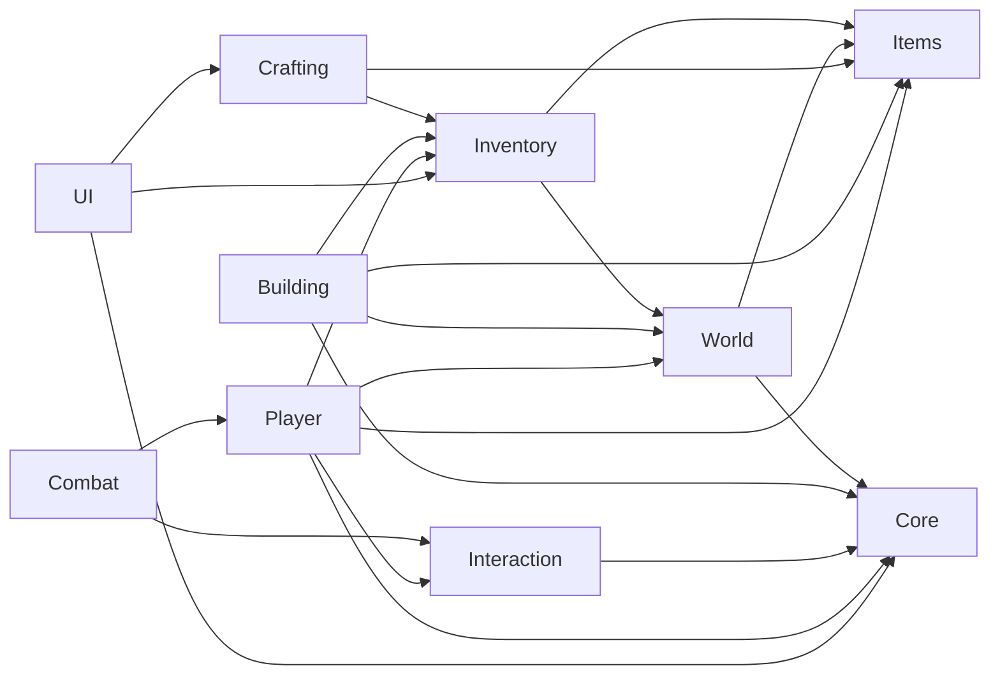

# Зависимости систем

Кто имеет право знать о ком. Ниже — договор, который соответствует текущему коду. Если для задачи хочется провести стрелку, которой здесь нет, сначала меняется этот договор, потом код.

Зависимость означает: файл модуля вызывает тип другого модуля, хранит на него поле или читает его данные. Вызов через чужой конкретный класс запрещён даже «временно из одного метода», потому что именно так топор узнал бы про дерево.

## Чем связываемся

Три способа, и они не взаимозаменяемы.

1. **Ссылка в Inspector** — для объектов, которые лежат в сцене или на одном префабе: игрок и его рука, HUD и контейнер, `GameRoot` и каталог.
2. **Реестр на время жизни объекта** — для того, что появляется и исчезает в мире: получатели удара, станции крафта, блокеры установки. Объект добавляет себя в `OnEnable` и убирает в `OnDisable`.
3. **Три глобальных чтения**, и только они:
   - `ItemCatalog.Active` — неизменяемый каталог;
   - `LocationContext.Active` — где игрок стоит сейчас;
   - `GameRoot.Active` — взять ссылку один раз, если объект создан кодом и не был в Inspector.

`GameRoot.Active` не превращается в `Get<T>()`. У корня три свойства: игрок, его инвентарь и сессионный `LocationState`. Режим управления лежит в `GameplayGate.State`. Дроп — статическая функция `WorldDropper`, потому что у него нет собственного состояния. Рантайм-объект копирует нужную ссылку в своё поле и дальше работает с ней.

`FindAnyObjectByType`, `FindObjectOfType` и поиск по имени в игровом кадре не используются. В редакторских утилитах поиск по сцене допустим.

События разрешены только у владельца состояния: контейнер сообщил `Changed`, виталы сообщили `Changed`, режим управления сообщил `Changed`. Подписчик — вид или сосед по префабу. Отдельной шины «любой может услышать всё» нет.

## Разрешённые зависимости

Стрелка «A → B» значит «A может знать о B».



Уточнения к стрелкам, которые легко прочитать слишком широко:

- `inventory → world` — только вызов `WorldDropper.Spawn`. Инвентарь не знает комнаты, дом и имя сцены.
- `player → world` — граница ходьбы и позиция, которую выдала локация. Игрок не загружает сцены.
- `combat → player` — урон по `PlayerVitals` и чтение позиции цели. Враг не вызывает `PlayerController` ради смены управления и не хранит `LevitatingSword`.
- `combat → interaction` — здоровье реализует `IImpactReceiver`. Пока меч не переведён, этой стрелки в коде нет, и враг не должен начинать зависеть от классов инструментов.
- `world → items` — дроп и размещённые объекты читают определения, чтобы знать спрайт и id. Мир не меняет каталог.
- `ui → player` — только чтобы показать виталы и послать уже существующую команду вроде открытия меню. UI не двигает персонажа и не тратит стамину сам.

`Items` ни на кого не ссылается. Определение предмета можно создать в редакторе без сцены.

`Interaction` не ссылается на `Items`, `Combat` и `Building`. Запрос умеет работать с `IImpactReceiver` и `Impact`. Что такое дерево, он не знает.

## Запрещённые зависимости

| Откуда | Куда нельзя | Почему |
| --- | --- | --- |
| Items | Player, UI, World, Combat | Предмет превратится в сценарий |
| Tool-презентация | `Tree`, `PlaceableObject`, `Slime`, `Enemy` | Это и есть жёсткая связка топора с деревом |
| Inventory | `HouseInterior`, `LevelWorld`, `HouseVisit`, классы UI | Слоты начнут знать дом и вёрстку |
| UI | Приватные массивы слотов, прямое создание `WorldItem` | Интерфейс станет вторым инвентарём |
| Crafting | Конкретные классы предметов и кнопки | Рецепт перестанет быть данными |
| CraftingStation | Список рецептов и инвентарь | Станция начнёт управлять крафтом |
| Building | Классы топора, дерева, конкретных префабов мебели | Установка должна создавать префаб из профиля |
| World objects | Методы `PlayerController` кроме тех, что локация сама вызывает для переноса | Дверь не управляет контроллером |
| Player | Список типов объектов мира | Рука бьёт через запрос |
| Любой геймплей | Имя сцены строкой, кроме `LocationFlow` | Новая локация не должна править предметы |
| Любой геймплей | Новый `static Instance` | Корень уже один |
| Destructible | Класс инструмента | Он принимает `Impact`, а не `Axe` |

`LocationFlow` — единственное место, где живёт соответствие определения локации и имени сцены. Дверь туда не подглядывает.

## Контракты между модулями

Публичным считается только то, что другая система имеет право вызвать. Внутренние методы анимации, вёрстки и генерации публичный контракт не расширяют.

### Core

- `ControlState.Push`, `Pop`, `Allows`, событие `Changed`.
- `Impact`, `ImpactResult`, `ImpactType`.

### Items

- Чтение `ItemDefinition`, `ToolProfile`, `PlaceableProfile`, `MaterialDefinition`, `LootTable`, `RecipeDefinition`, `PlacementPolicy`.
- `ItemCatalog.Find` и перечень рецептов.
- Записи в каталог из игрового кода нет. Наполнение — редактор и ассеты.

### Inventory

- `ItemStack`.
- `ItemContainer`: чтение слота, `TryAdd`, `TryRemove`, перенос, проверка места, `Changed`.
- `PlayerInventory` снаружи выглядит так же, пока UI не переведён на контейнер напрямую. Новых знаний о мире его публичные методы не получают.

### Interaction

- `IImpactReceiver.Receive(in Impact)`.
- `IInteractable.Interact(InteractionContext)`.
- `ImpactQuery.Collect` и выбор одной лучшей цели.
- `InteractionQuery` для клавиши E.

Реализация `Receive` остаётся внутри объекта. Запрос не приводит цель к `Tree`.

### World

- `LocationContext`: вид, регион, граница, определение локации.
- `LocationFlow.Enter` / `Exit` с определением локации и id точки.
- `WorldDropper.Spawn(itemId, count, origin)`.

### Building

- `PlacementRules.Evaluate` и `Snap`.
- Команда «создать префаб профиля в точке» после успешного списания предмета.

### Crafting

- `CraftingSystem.CollectVisible`, `DenyReason`, `TryCraft`.
- `CraftingStation` снаружи: id и радиус. Регистрация себя в общем списке станций — деталь реализации, рецепты её не касаются.

### Player

- Намерения `PlayerInput`.
- `PlayerVitals.TakeDamage` и трата стамины для руки и для укуса врага.
- Рука читает выбранный слот и профиль. Наружу ей не нужен широкий интерфейс, пока меч не станет второй презентацией.

### Combat

- Здоровье актёра принимает `Impact`, когда этап боя начат.
- Контактный урон зовёт `PlayerVitals`.
- Движение существа наружу не торчит.

### UI

Контракта, который вызывал бы геймплей, у UI нет. Геймплей не включает конкретный `Image` и не пишет в `Text`. Исключение переходного периода: подсказка установки, которую `PlacementSystem` рисует сам. Новые подсказки так не делаем. Старую переносим в UI в этапе интерфейса, не раньше.

## Как это ложится на текущий код

Сейчас запреты уже нарушены. Это список того, что миграция расцепляет, а не повод править всё в одном коммите.

| Текущая связь | Чем заменяется |
| --- | --- |
| `Axe` → `IDamageable.ApplyDamage(1)` и собственные щепки | Презентация шлёт `Impact` из профиля, щепки делает `ImpactFeedback` |
| `Tree` → `ItemIds.Wood` и `WorldItem.Toss` | `LootDropper` и таблица |
| `Enemy` → `LevitatingSword` | Враг принимает `Impact`, на позднем этапе |
| `PlayerInventory` → `HouseVisit`, `LevelWorld`, `AddComponent` систем | `WorldDropper` и явные компоненты на префабе |
| `ItemArt` → поиск `PlayerInventory` ради иконки меча | Спрайт на `ItemDefinition` |
| `DefaultContent` → switch по всем id | Ассеты каталога как единственный источник |
| `HouseVisit` знает имя сцены, дверь ищет игрока | `LocationFlow` и `IInteractable` |
| `PlaceableObject` сам и станция, и добыча, и прочность, и дом | Фасад пока жив; станция, `Destructible` и добыча становятся соседними компонентами |
| `PlayerCombat` спрашивает `SlimeSpawnButton` и `WorldMenu` | Один ответ «указатель над UI» и `ControlState` |
| `ItemDefinition.Fits` → switch по `PlacementZone` | `PlacementPolicy` |

`CraftingSystem` → инвентарь и `PlacementRules` → контекст локации уже направлены правильно. Их сохраняем.

## Направление данных

Состояние течёт в одну сторону.

```text
ввод → намерение → проверка ControlState → команда системы → изменение состояния → событие → вид
```

Вид не пишет в состояние в обход команды. Инструмент не пишет в прочность в обход `Receive`. Рецепт не списывает слот в обход контейнера.

Если два модуля должны узнать друг о друге в обе стороны, между ними вставляется узкий тип из Core или Interaction (`Impact`, `ItemStack`, id локации), а не ссылка на конкретный компонент. Дереву достаточно `Impact`. Инвентарю достаточно `itemId` и количества, которые он отдаёт дроперу.
